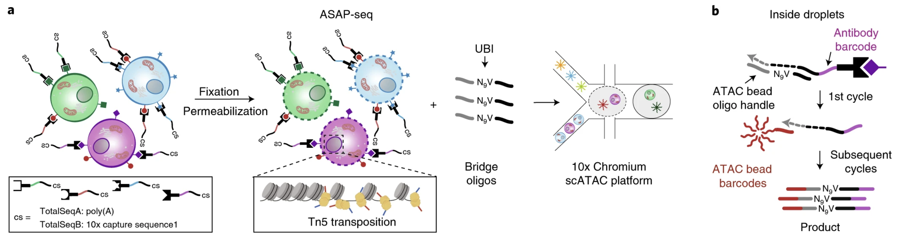

```{r}
#| label: load_libraries_data
#| echo: false
# Load libraries and data

```

Approximate time: XX minutes

## Learning objectives 

In this lesson, we will:

- Discuss the pros and cons of different single-cell modalities
- Describe the overaching experimenal concept
- List common analyses that can be accomplished with multiomics

## Overview of lesson

Before designing an experiment and collecting samples, it is important to determine which assays will be most beneficial to answering your biological question. Here, we introduce the concept of single-cell multiomics which allows you capture multiple pieces of information (RNA, ATAC, protein expression) within a singular cell. Each modality comes with its own advantages and disadvantages that will determine which analyses you can perform with your data.

## What is single-cell multiomics?

The field of single-cell sequencing has evolved beyond its intial focus on gene expression (RNA) capture. Additional methods have been developed to capture additional information for **each cell**, including the epigenome (chromatin accessibility), proteome, and more. Experiments that contain more than one modality is what is typically referred to a multiomics experiment.

Two of the most popular protocols that captures all three RNA, ATAC, and protein are [ASAP-seq](https://www.nature.com/articles/s41587-021-00927-2) and [TEA-seq](https://elifesciences.org/articles/63632). This then begs the question, when is it appropriate to use which modality? [Kim et. al (2024)](https://www.sciencedirect.com/science/chapter/bookseries/pii/S1937644824001187) summarized the main principles and use cases for each modality. Here, we summarize the key points to serve as a reference for which modality best suits the experimental question or design that you may be using.

Table: Summary of common single-cell modalities. {#tbl-modality_contrast}

| | scRNA-seq | scATAC-seq | ADT (surface protein) |
|---|---|---|---|
| **Coverage** | RNA abundance and splicing events | DNA chromatin accessibility and epigenetic regulation | Surface protein expression |
| **Advantages** | • Method of choice for transcriptional heterogeneity<br>• Captures cell-to-cell expression variability | • Short sample prep time and works with few cells<br>• Accessible and cost-effective | • Protein expression is _not_ sparse<br>• Insight into cell communication and signaling<br>• Paired with RNA, better resolves cellular heterogeneity |
| **Limitations** | • Low capture efficiency and high dropout making data noisy, sparse, and variable<br>• Incomplete genome coverage, especially in rare cell populations | • Non-specific antibody binding (background counts)<br>• Composition bias from uneven capture efficiency | • Requires known antibodies (challening for non-model) |
| **Applications** | • Cell type identification<br>• Cell subpopulation discovery<br>• Gene expression dynamics<br>• Cellular heterogeneity | • *Cis*/*trans* regulatory element analysis<br>• Gene regulatory dynamics<br>• Transcription factor activity<br>• Epigenetic changes<br>• Motif analsis<br> | • Gene–protein correlation<br>• Cell signaling pathways<br>• Cell states and cell types |


## How modalities are captured

::: {#fig-asap_seq .figure}
{width=900}

Schematic how the ASAP-seq protocol captures single-cell RNA, ATAC, and protein expression.<br>
_Image source: [Mimitou et al. (2021)](https://www.nature.com/articles/s41587-021-00927-2)_
::: 

TODO: talk to mandovi

## Downstream analyses

TODO: take figures from each modality to collate into a single figure
if possible color them for each modality

colorblind friendly:
gene = blue
protein = orange
dna = green

https://www.nature.com/articles/s41576-023-00586-w

***

[Next Lesson >>](tmp.qmd)

[Back to Schedule](../schedule/schedule.qmd)