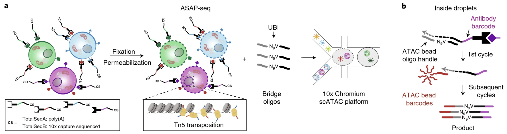
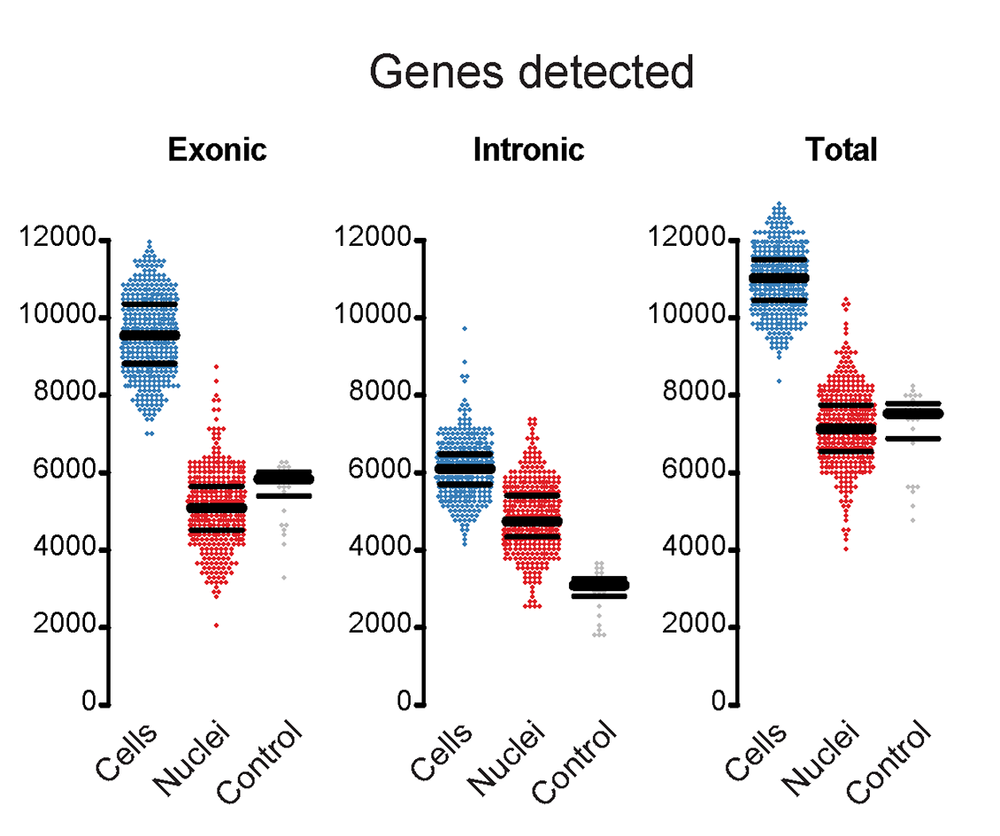
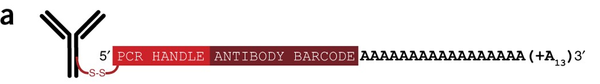
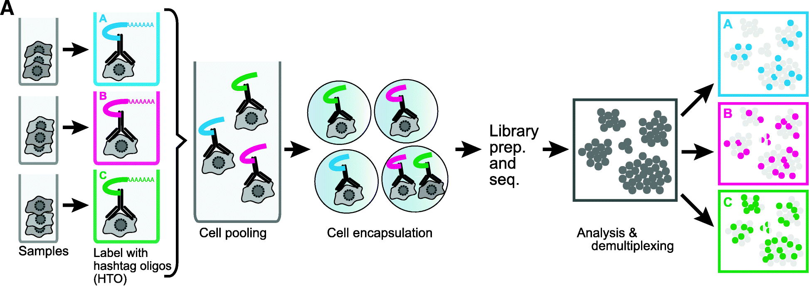
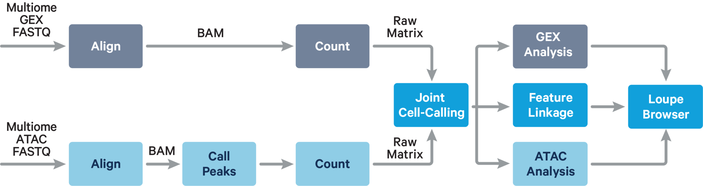
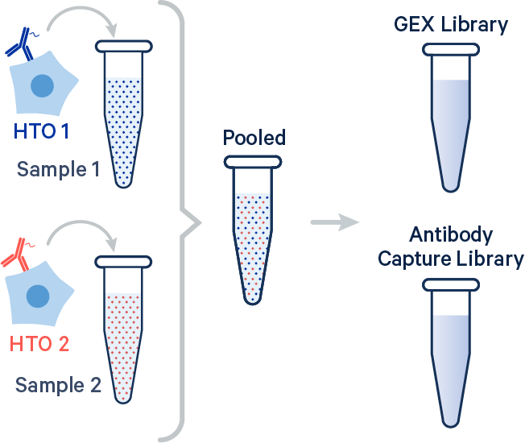

```{r}
#| label: load_libraries_data
#| echo: false
# Load libraries and data

```

Approximate time: 15 minutes

## Learning objectives 

In this lesson, we will:

- Discuss the pros and cons of different single-cell modalities
- Describe the overarching experimental concept
- List common analyses that can be accomplished with multiomics

## Overview of lesson

Before designing an experiment and collecting samples, it is important to determine which assays will be most beneficial to answering your biological question. Here, we introduce the concept of single-cell multiomics which allows you to capture multiple pieces of information (RNA, ATAC, protein expression) within a singular cell. Each modality comes with its own advantages and disadvantages that will determine which analyses you can perform with your data.

## What is single-cell multiomics?

The field of single-cell sequencing has evolved beyond its intial focus on gene expression (RNA) capture. Additional methods have been developed to capture additional information for **each cell**, including the epigenome (chromatin accessibility), proteome, and more. Experiments that contain more than one modality is what is typically referred to as a multiomics experiment.

::: {#fig-asap_seq .figure}
{width=900}

Schematic how the ASAP-seq protocol captures single-cell RNA, ATAC, and protein expression.<br>
_Image source: [Mimitou et al. (2021)](https://www.nature.com/articles/s41587-021-00927-2)_
::: 

Two of the most popular protocols that captures all three RNA, ATAC, and protein are [ASAP-seq](https://www.nature.com/articles/s41587-021-00927-2) and [TEA-seq](https://elifesciences.org/articles/63632). This then begs the question, when is it appropriate to use which modality? [Kim et. al (2024)](https://www.sciencedirect.com/science/chapter/bookseries/pii/S1937644824001187) summarized the main principles and use cases for each modality. Here, we summarize the key points to serve as a reference for which modality best suits the experimental question or design that you may be using.

Table: Summary of common single-cell modalities. {#tbl-modality_contrast}

| | scRNA-seq | scATAC-seq | ADT (surface protein) |
|---|---|---|---|
| **Coverage** | RNA abundance and splicing events | DNA chromatin accessibility and epigenetic regulation | Surface protein expression |
| **Advantages** | • Method of choice for transcriptional heterogeneity<br>• Captures cell-to-cell expression variability | • Short sample prep time and works with few cells<br>• Accessible and cost-effective | • Protein expression is _not_ sparse<br>• Insight into cell communication and signaling<br>• Paired with RNA, better resolves cellular heterogeneity |
| **Limitations** | • Low capture efficiency and high dropout making data noisy, sparse, and variable<br>• Incomplete genome coverage, especially in rare cell populations | • Non-specific antibody binding (background counts)<br>• Composition bias from uneven capture efficiency | • Requires known antibodies (challening for non-model) |
| **Applications** | • Cell type identification<br>• Cell subpopulation discovery<br>• Gene expression dynamics<br>• Cellular heterogeneity | • *Cis*/*trans* regulatory element analysis<br>• Gene regulatory dynamics<br>• Transcription factor activity<br>• Epigenetic changes<br>• Motif analsis<br> | • Gene–protein correlation<br>• Cell signaling pathways<br>• Cell states and cell types |


## How modalities are captured

<!-- TODO: talk to mandovi

- People usually use kit from 10x for either (RNA + protein) or (RNA + ATAC)
- ATAC + RNA
    - Must work with single nuclei 
      - have to make sure nuclei is intact
      - removing debris
      - you can do sorting, but you have practice because it adds more time and can put a lot of pressure on nuclei (it might pop)
    - So surface protein is out the question (removing cell membrane)
    - No mito
    - If there is a protein inside the nuclear membrane, it is _possible_ to do the protein expression as well (but in Mandovi's experience it does not work as well as cell surface when you hash them)
    - Because nuclei, RNA can leak out if the nuclei are frozen. Combining nuclear protein staining with RNA and protein can be challenging
      - protein stainig takes a while (~1 hour) which can cause RNA to degrade in the meantime
    - Annotation + clustering is done usually on RNA so it's important to make sure that RNA quality is good (recommend RNAase inhibitor)
      - The size of the barcode bead is finite, so it gets 50% RNA and 50% ATAC instead of 100% of material
    
- Mandovi recommends doing (RNA + ATAC) and then doing (RNA + protein) separately

- RNA + ADT (CITE)
  - Viability is important (checking quailty of cells)
  - You don't have to do cell suface protein, there are other panels now (i.e cytosolic )
  - It is important to optimize the concentration of antibodies in use
    - Add isotype controls (negative control)
    - Similar logic to flow
  - If you do CD45 then it is tricky to do hashing at the same time
    - Hashing antibodies are a combination of CD45 and MHC1 (?) so they can compete
  
- For both sample prep there is a significant loss of cells during sample prep
  - Not any sample will qualify for these experiments
  - Because you either incubate or lyse cells, then during washing (after lysing or to remove unbound anitbodies) which can lose a lot of cells
  - So if you have limited concentration of sample

- When picking experiment
  - Fewer UMIs for multiome as compared to scRNA-seq
  - There are a group of people who believe data for multiome is better when you do 1/2 for RNA and 1/2 for ATAC (sequenced separately) _of the same sample_
    - Nuclei are not the same (tradeoff)
    - This will improve levels of ATAC and RNA expression
-->

In practice, most multiomic experiments are run with commercial kits from 10x Genomics, which pair RNA with one other modality: either chromatin accessibility ([10x Genomics Multiome ATAC + Gene Expression](https://www.10xgenomics.com/support/epi-multiome/documentation/steps/sample-prep/nuclei-isolation-for-single-cell-multiome-atac-plus-gene-expression-sequencing)) or protein expression with CITE-seq ([Stoeckius et al. (2017)](https://www.nature.com/articles/nmeth.4380)). The two pairings call for very different sample preparation, and each comes with its own trade-offs.

### RNA + ATAC

Measuring chromatin accessibility requires the transposase to reach the DNA, so the RNA + ATAC multiome is performed on **isolated nuclei** rather than whole cells (@fig-multiome_workflow).

::: {#fig-multiome_workflow .figure}
{width=900}

TODO Workflow of the Single Cell Multiome ATAC + Gene Expression assay: nuclei are isolated, transposed in bulk, and then partitioned so that RNA and ATAC fragments from the same nucleus share a cell barcode.<br>
_Image source: [10x Genomics](https://www.10xgenomics.com/products/single-cell-multiome-atac-plus-gene-expression)_
::: 

The quality of the nuclei preparation largely decides the quality of the data. Key challenges when working with nuclei include:

- **Keeping nuclei intact:** Nuclei are fragile. Sorting can clean up the suspension, but it adds time and mechanical stress that can rupture nuclei.
- **Removing debris:** Debris from lysed cells can clog the microfluidics and add background ambient RNA ([10x Genomics nuclei isolation protocol](https://www.protocols.io/view/mouse-heart-nuclei-isolation-for-10x-genomics-sing-j5pwcq5pf.pdf)).
- **Protecting RNA:** Nuclear RNA readily leaks out, especially from frozen samples. Because cell type annotation and clustering are usually done on the RNA modality, adding an RNase inhibitor to the lysis and wash buffers is recommended ([Gladstone nuclei isolation protocol](https://www.protocols.io/view/isolation-of-nuclei-from-frozen-tissue-for-snmulti-6uchesw.html)).

Working with nuclei instead of whole cells also changes what you can measure, compared with standard scRNA-seq:

- **No surface protein:** The cell membrane is removed, so surface proteins can no longer be measured.
- **Limited intranuclear protein:** Proteins inside the nucleus can be measured. However, intranuclear staining does not perform as well as surface staining. The ~hour-long antibody incubation time gives RNA more time to degrade.
- **No mitochondrial reads:** Mitochondrial transcripts are largely absent, due to removal of the cytoplasm. Therefore, using mitochondria to identify stressed/dying cells is not possible ([Bakken et al. (2018)](https://journals.plos.org/plosone/article?id=10.1371/journal.pone.0209648)).
- **Fewer UMIs per cell:** Nuclei hold less RNA than whole cells, so fewer genes are detected per nucleus (@fig-cell_vs_nuclei), and each nucleus contributes material to two libraries rather than one. 10x Genomics reports comparable sensitivity after downsampling, but this comparison is against single-nucleus input ([10x Genomics technical note](https://cdn.10xgenomics.com/image/upload/v1660261286/support-documents/CG000372_TechNote_Multiome_ATAC_GEX_DataComparison_RevA.pdf)).


::: {#fig-cell_vs_nuclei .figure}
{width=600}

Number of genes detected in matched single-cell (blue) and single-nucleus (red) RNA-seq of mouse cortical neurons. Nuclei consistently yield fewer detected genes than whole cells.<br>
_Image source: [Bakken et al. (2018)](https://journals.plos.org/plosone/article?id=10.1371/journal.pone.0209648)_
::: 

### RNA + protein (CITE-seq)

CITE-seq uses oligo-tagged antibodies to measure protein alongside RNA in whole cells (@fig-cite_seq). Panels are no longer limited to surface proteins, and intracellular targets can also be profiled.

::: {#fig-cite_seq .figure}
{width=900}

Design of a CITE-seq antibody. Each antibody is conjugated to an oligo containing a PCR handle, an antibody-specific barcode, and a poly-A tail, so it is captured on the same beads as mRNA.<br>
_Image source: [Stoeckius et al. (2017)](https://www.nature.com/articles/nmeth.4380)_
::: 

Because CITE-seq relies on antibody staining, many of the considerations are similar to flow cytometry:

- **Cell viability:** Whole, healthy cells are needed, so viability should be checked before staining.
- **Antibody titration:** Each antibody should be titrated, since oligo-conjugated antibodies at excessive concentrations mainly increase background signal ([Buus et al. (2021)](https://elifesciences.org/articles/61973)).
- **Isotype controls:** Include them as negative controls. They can also be used by normalization methods to remove cell-level technical noise ([Mulè et al. (2022)](https://www.nature.com/articles/s41467-022-29356-8)).
- **Compatibility with cell hashing:** Some protein targets can interfere with sample multiplexing, described below.

Cell hashing uses antibodies against ubiquitously expressed surface proteins so that cells from different samples can be **pooled** and later separated (@fig-cell_hashing).

::: {#fig-cell_hashing .figure}
{width=900}

Each sample is labeled with a uniquely barcoded antibody before pooling, allowing cells to be assigned back to their sample and doublets to be identified.<br>
_Image source: [Stoeckius et al. (2018)](https://genomebiology.biomedcentral.com/articles/10.1186/s13059-018-1603-1)_
::: 

Hashtag antibodies work by binding to proteins found on almost every cell ([BioLegend TotalSeq](https://www.biolegend.com/en-us/totalseq/single-cell-rna/multiplex-samples-and-hashtags)):

- **Human samples:** CD298 and β2-microglobulin
- **Mouse samples:** CD45 and MHC class I

This matters for **mouse** experiments. If your protein panel also includes an CD45 antibody, the panel antibody and the hashtag antibody will try to bind the same protein and block each other. As a result, both the CD45 protein measurement and the sample assignment can be unreliable.

## Choosing an experiment

When deciding between these workflows, keep in mind the considerations in @tbl-experiment_choice.

Table: Practical considerations when choosing a multiomics experiment. {#tbl-experiment_choice}

| | RNA + ATAC (multiome) | RNA + protein (CITE-seq) |
|---|---|---|
| **Cell loss** | Cells are lysed to isolate nuclei, then washed repeatedly to remove debris. Every wash loses material. | Cells are incubated with antibodies, then washed repeatedly to remove unbound antibody. Every wash loses cells. |
| **Sample suitability** | Samples with low cell numbers may not leave enough nuclei to load. | Samples with low cell numbers may not leave enough cells to load. |
| **Sequencing depth** | Expect fewer UMIs per cell than standard scRNA-seq. | Comparable to standard scRNA-seq, since whole cells are used. |

::: callout-important
# Experimental design help

For more detailed questions regarding experimental design, we would encourage you to reach out to our consulting team at the [Harvard Chan Bioinformatics Core](https://hsph.harvard.edu/research/bioinformatics/) for guidance. For technical questions regarding sample preparation and protocols, the [Single-cell Core at HMS](https://singlecellcore.hms.harvard.edu/) is another fantastic resource to get help.

:::

## Pre-processing

After sequencing, the raw reads for each modality need to be aligned and counted per cell barcode. 10x Genomics provides a dedicated pipeline for each of the two common pairings: **Cell Ranger ARC** for RNA + ATAC, and **Cell Ranger multi** for RNA + protein.

### Cell Ranger ARC (RNA + ATAC)

[Cell Ranger ARC](https://www.10xgenomics.com/support/software/cell-ranger-arc/latest/algorithms-overview/algorithms-overview) processes data from the Multiome ATAC + Gene Expression kit with the `cellranger-arc count` command. The gene expression and ATAC libraries are processed in two parallel branches, which come together at cell calling (@fig-cellranger_arc).

::: {#fig-cellranger_arc .figure}
{width=900}

Gene expression and ATAC reads are aligned and counted in parallel, then combined during joint cell calling before downstream analysis.<br>
_Image source: [10x Genomics](https://www.10xgenomics.com/support/software/cell-ranger-arc/latest/algorithms-overview/algorithms-overview)_
:::

### Cell Ranger multi (RNA + protein)

[Cell Ranger multi](https://www.10xgenomics.com/support/software/cell-ranger/latest/analysis/running-pipelines/cr-3p-multi) processes several library types from the same GEM well together with the `cellranger multi` command. For a CITE-seq experiment, these are the gene expression library and the antibody capture (ADT) library (@fig-cellranger_multi).

::: {#fig-cellranger_multi .figure}
{width=450}

Samples are labeled with hashtag antibodies (HTOs) and pooled, producing a gene expression (GEX) library and an antibody capture library.<br>
_Image source: [10x Genomics](https://www.10xgenomics.com/support/software/cell-ranger/latest/analysis/running-pipelines/cr-3p-multi)_
:::

Protocols that capture all three modalities, such as the DOGMA-seq dataset (used in this workshop), do not fit neatly into either pipeline. Instead, the data is run through **both**: Cell Ranger ARC processes the RNA + ATAC libraries, and Cell Ranger multi processes the RNA + ADT libraries (including the hashtags). The cells called by Cell Ranger ARC are then used to keep the same set of cell barcodes across all three modalities.

## Downstream analyses

TODO: take figures from each modality to collate into a single figure

https://www.nature.com/articles/s41576-023-00586-w

***

[Next Lesson >>](02_dataset.qmd)

[Back to Schedule](../schedule/schedule.qmd)