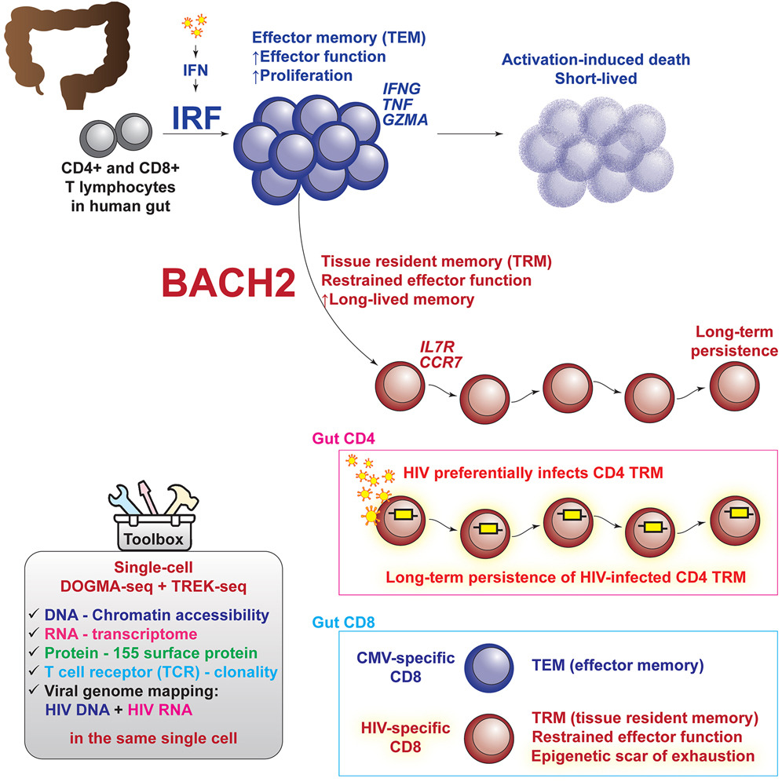
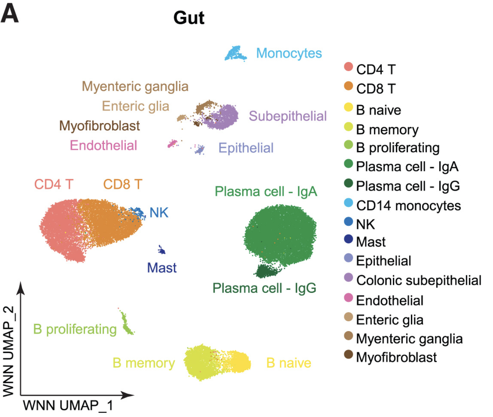

```{r}
#| label: load_libraries_data
#| echo: false
# Load libraries and data

```

Approximate time: 35 minutes

## Learning objectives 

In this lesson, we will:

- Learning Objective 1
- Learning Objective 2
- Learning Objective 3

## Overview of lesson

When doing XYZ...

## Mechanisms of HIV-1 persistence in the gut

Throughout this workshop, we will be utilizing a dataset from [Wei et al. (2025)](https://www.cell.com/immunity/fulltext/S1074-7613(25)00331-0). In this experiment, they ran [DOGMA-seq](https://www.nature.com/articles/s41587-021-00927-2) on gut tissue from healthy samples and people living with HIV (PLWH) being treated with antiretroviral therapy (ART). As a result, they were able to characterize the transcriptome, epigenome, and proteome of HIV-1 infected cells in contrast to healthy cells.

As a dataset that makes use of hashing (pooled samples), RNA, ATAC, and protein expression, this provides a great learning opportunity to experience how to process each of these modalities (@tbl-modalities).

| Modality | Measures | Used for |
|----------|----------|----------|
| Hashtag oligos (HTO) | Sample of origin | Demultiplexing pooled samples, doublet removal |
| RNA | Gene expression | Clustering, marker genes, cell type annotation |
| ATAC | Chromatin accessibility | Epigenomic profiles, transcription factor motifs |
| Antibody-derived tags (ADT) | Surface protein abundance | Validating cell types, protein markers |

: Modalities measured in the DOGMA-seq dataset. {#tbl-modalities}

### Key findings

In 2025, [Wei et al.](https://www.cell.com/immunity/fulltext/S1074-7613(25)00331-0) published results that showcased which factors promoted HIV-1 persistence in the gut. This study identified [_BACH2_](https://www.genecards.org/card/BACH2) as a key factor found in HIV-1 persistent T cells in the gut. The authors were able to identify this link across the transcriptome, epigenome, and proteome by using the DOGMA-seq protocol (@fig-dataset_abstract).

::: {#fig-dataset_abstract .figure}
{width=500}

Role of BACH2 in HIV-1 persistent T cells of the gut.<br>
_Image source: [Wei et al. (2025)](https://www.cell.com/immunity/fulltext/S1074-7613(25)00331-0)_
::: 

TODO flush out this section

### Samples

This dataset includes 17,642 cells in PLWH and 22,422 cells in HIV− individuals. Each PLWH donor was tagged with oligo-barcoded antibodies, pooled, and then sequenced. From all of these cells, the authors were able to identify 16 distinct cell types in the dataset (@fig-dataset_umap).

::: {#fig-dataset_umap .figure}
{width=500}

UMAP of cell types identified in the samples collected.<br>
_Image source: [Wei et al. (2025)](https://www.cell.com/immunity/fulltext/S1074-7613(25)00331-0)_
::: 

To start, we will be using this heterogeneous population of cells to showcase how multiomics datasets are processed. We will first begin with the antibody hashes and protein expression before moving on to the ATAC-seq material.

::: callout-note
# scRNA-seq

Note that we will not discuss the upstream methods used to process [scRNA-seq as we have a separate workshop](https://hbctraining.github.io/Intro-to-scRNAseq/) that details those steps in much more depth.
:::

Lastly, we will pull all three molecular modalities together to run further downstream analyses.

## Getting set-up

If you have not already, be sure to download the dataset so that you can access the files used in this analysis. The data can be downloaded from [this link](TODO).

### Project organization

When you have large amounts of data, it is easy to lose track of your files and become overwhelmed. We tend to prioritize the analysis and, in the excitement of getting a first look at our data, we often forget to consider how we are going to manage our data and files. This is a common mistake, as **data management is often an afterthought** when it should be a key part of the workflow from the very beginning. The [HMS Data Management Working Group](https://datamanagement.hms.harvard.edu/) discusses in-depth some aspects to consider beyond the data creation and analysis.

One important aspect of data management is organization. For each experiment you work on and analyze data for, it is considered best practice to get organized by creating **a planned storage space**. We will do that for our analysis. 


::: callout-important
# Note for Windows OS users
After unzipping, check whether you have a nested `sc_multiomics/sc_multiomics` folder. If so, move everything from the inner folder up into the outer one, then delete the empty inner folder.
:::

### Opening RStudio

We can open the R Project up and see that the provided file structure should look like @fig-rstudio_setup.

::: {#fig-rstudio_setup .figure}
{width=900}

TODO Correct setup for RStudio to start the workshop.
::: 

If your RStudio session looks similar to the image above, then you are ready to start!

### New script

Next, open a new Rscript file and start with some comments to indicate what this file is going to contain. Ideally, we will have one script per major step in our analysis. For this first script, we will be loading our data and performing quality control - as indicated in the header.

Loading your libraries at the top of the script will also allow you to easily keep track of which libraries you are using and to load them all at once in the beginning.

```{r}
#| label: header_libraries
# Demultiplexing HTO and protein expression ADT
# Single-cell multiomics modules
# Author: Harvard Chan Bioinformatics Core
# Created: October 2026

# Load libraries
library(tidyverse)
library(Seurat)

# Set seed
set.seed(123456789L)
```

Save the Rscript as `01_demultiplex_hto_and_protein.R` in your main folder. Your working directory should look something like this:

```{r}
#| label: full_data_structure
#| eval: false
TODO
```


## Sample metadata

A great way to keep track of your samples is to create a samples table that contains all the relevant metadata. This can include fields such as sex, batch, date sequenced, and more. Collating all this into one spreadsheet will make it easier to match our dataset with the correct experimental conditions.

Inside the `data/` folder, we have provided one such metadata file called `samples.tsv`. This file contains information about each sample in our dataset. We will first load this in to familiarize ourselves with the data we will be using in the next step.

```{r}
#| label: load_samples_metadata
#| eval: false
# Load sample metadata
df_meta <- read_tsv("data/samples.tsv")
df_meta
```

```{r}
#| label: tbl-load_samples_metadata
#| tbl-cap: Metadata for each of the samples in this gut HIV dataset.
#| echo: false
df_meta <- read_tsv("data/samples.tsv")
df_meta %>% knitr::kable()
```

This table is valuable because it gives us some key information about each sample. For example, we can see that we have multiple sequencing runs from the same patient for many of the HIV negative samples. More consequentially, in the `patient` column, we see the label `pooled` for all of the HIV positive samples.

Recall earlier that we discussed that some samples were first tagged with an antibody and then pooled into a singular run. This is a common cost-saving technique used to sequence multiple samples at once. However, in doing so, we must computationally determine which cell comes from which sample by using those hash sequences. This process is called **demultiplexing** which we will discuss more deeply in the next lesson.

***

[Next Lesson >>](03_demultiplexing.qmd)

[Back to Schedule](../schedule/schedule.qmd)