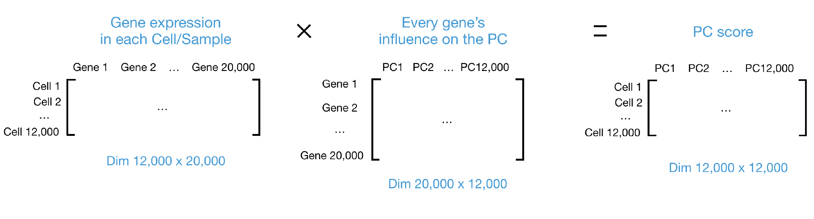

```{r}
#| label: load_libraries_data
#| echo: false
# Load libraries and data
library(Seurat)
library(tidyverse)
library(harmony)

# Set seed
set.seed(123456789L)

# Load demultiplexed Seurat object
seurat_demux <- readRDS("data/processed_seurat_objects/seurat_demux.RDS")
```

Approximate time: 80 minutes

## Learning objectives 

In this lesson, we will:

- Normalize protein counts with CLR and exclude isotype controls
- Run PCA and UMAP on protein expression and correct library batch effects with Harmony
- Compare RNA and protein expression to see how each modality resolves cell types
- Annotate cell types using RNA and protein markers together

## Overview of lesson

In this section, we will normalize the protein counts, reduce their dimensionality, and check whether the protein data alone separates our cells into sensible groups.

## Protein expression (ADT)

Alongside RNA, each cell in our dataset was stained with a panel of 165 oligo-tagged antibodies, giving us a measure of surface protein abundance for every cell. Proteins are often the most direct readout of cell type.

Many of the markers used to define immune cell types (CD3, CD4, CD8, CD19, HLA-DR) were originally defined by their protein expression with flow cytometry.

```{r}
#| label: set_default_assay_adt
# Set default assay to ADT
DefaultAssay(seurat_demux) <- "ADT"
```

### Isotype controls

Not every antibody in the panel targets a human protein. **Isotype controls** are antibodies of the same class as the real antibodies but with no target in human cells. Any counts they receive come from non-specific binding, so they tell us the level of background noise in each cell. They are useful for quality control, but they carry no biological signal, so we will exclude them from the downstream analysis.

Our panel contains nine isotype controls:

```{r}
#| label: isotypes
# Isotype control antibodies in the panel
isotypes <- c("ArmenianHamsterIgG",
              "Mouse-IgG1-isotype", "Mouse-IgG2a-isotype", "Mouse-IgG2b-isotype",
              "RatIgG1k", "RatIgG1l", "RatIgG2a", "Rat-IgG2b-isotype", "RatIgG2c")
```

We can check the expression of each of these isotypes to confirm their expression levels.

```{r}
#| label: fig-isotype
#| fig-cap: Expression distribution of isotype controls in the protein panel.
#| fig-width: 9
#| fig-height: 8
# Isotype control expression by HIV status
VlnPlot(seurat_demux,
        group.by = "hiv_status",
        features = isotypes,
        assay = "ADT",
        pt.size = 0)
```

We can see that there is pratically zero expression of each of these isotypes which confirms that we can proceed with our data as is.

### Normalization

Antibody counts behave differently from RNA counts, which are typically log-normalized. Each antibody has its own background level, and a few highly abundant proteins can make up a large share of a cell's counts. For this reason, we normalize with the **centered log-ratio (CLR)** transform, just as we did for the hashtags in the demultiplexing lesson. Setting `margin = 2` normalizes each cell independently. As a result, each protein's count is compared to the geometric mean of all the proteins in that cell.

```{r}
#| label: adt_norm
# CLR normalization across proteins within each cell
seurat_demux <- NormalizeData(
  seurat_demux,
  normalization.method = "CLR",
  margin = 2)

seurat_demux
```

### Feature selection

Recall that our protein panel is comprised of 165 antibodies - which is a small number compared to the ~36,000 genes in the RNA assay. In a typical scRNA workflow, this would be where we identify the top variable genes in the datset. However, since there are so few protein, we will instead use every protein except the isotype controls.

```{r}
#| label: adt_features
# Use all proteins except the isotype controls
adt_features <- setdiff(rownames(seurat_demux[["ADT"]]), isotypes)
VariableFeatures(seurat_demux) <- adt_features

length(adt_features)
```

We are left with `r length(adt_features)` proteins, which we scale before running PCA.

```{r}
#| label: adt_scale
# Scale protein expression
seurat_demux <- ScaleData(seurat_demux)
seurat_demux
```

### PCA

Principal Component Analysis (PCA) is a method that allows us to summarize and reduce the dimensions of our dataset to emphasize the variation and similarity of our data. Utilizing PCA, we are able to identify strong patterns in our dataset to group cells together.


#### Calculating PCA

::: {.callout-note collapse="true"}
# Video on how PCA is calculated

For a more **detailed explanation on PCA**, please [look over this lesson](https://hbctraining.github.io/Intro-to-scRNAseq/lessons/06_theory_of_PCA.html) (adapted from StatQuests/Josh Starmer's YouTube video). We also strongly encourage you to explore the video [StatQuest's video](https://www.youtube.com/watch?v=_UVHneBUBW0) for a more thorough understanding.
:::

Let's say you are working with a single-cell RNA-seq dataset with _12,000 cells_ and you have quantified the expression of _20,000 genes_. The schematic below demonstrates how you would go from a cell-by-gene matrix to principal component (PC) scores for each individual cell. This same principle applies for the `ADT` assay, except we use protein instead of genes.

::: {#fig-PCA_schematic .figure}
{width=900}

Schematic of PCA: from a cell-by-gene count matrix to principal component scores per cell.
::: 

Now that we have a general idea of what the PCA calculation does, we can compute `pca_adt` using the `RunPCA()` function. At this step, we will also set the `reduction.name` to ensure that we can keep track of which assay a calculation was computed on.

```{r}
#| label: adt_pca
# PCA on protein expression
seurat_demux <- RunPCA(
  seurat_demux,
  npcs = 30,
  assay = "ADT",
  reduction.name = "pca_adt",
  reduction.key = "adtPC_",
  verbose = FALSE,
  seed.use = 123456789L)
```

#### Visualizing PCA

Principal components analysis (PCA) stratifies the data by variance. Points closer together are more similar, and points further apart are more dissimilar. We can visualize the PCA results using `DimPlot()` to see if we can identify if there is any technical or biological variable is driving the separation of cells.

```{r}
#| label: fig-pca_adt_library
#| fig-cap: Protein PCA colored by library (left) and HIV status (right).
#| fig-width: 12
#| fig-height: 5.5
# Protein PCA by library and HIV status
DimPlot(seurat_demux,
        group.by = c("orig.ident", "hiv_status"),
        reduction = "pca_adt",
        shuffle = TRUE)
```


The libraries are spread out along the first principal component: `PT1` forms its own group at one end, `PT4` sits at the other, and `PT2` occupies its own region at the top of the plot. In this dataset, **HIV status and library are confounded**. Every PLWH cell comes from one of the four pooled `PT` libraries. Therefore, we cannot yet tell how much of this separation is biology and how much is a technical difference between sequencing runs. We will keep an eye on this in the UMAP.

#### PCA weights

We can additionally see which proteins have the highest weights (positive and negative) for each principal component. Ideally, we would hope to see cell type markers at this point.

```{r}
#| label: adt_pca_loadings
# Top proteins for the first 5 PCs
print(seurat_demux[["pca_adt"]],
      dims = 1:5, nfeatures = 5)
```

The later PCs look like cell type markers. `adtPC_2` separates T cells (CD2, CD3, CD4, CD5, CD7). `adtPC_3` and `adtPC_4` are driven by B cell markers (CD21, CD22, CD35, HLA-DR). `adtPC_1`, however, mixes markers from many lineages, which fits with it **separating libraries** rather than cell types.

### UMAP

[UMAP]((https://umap-learn.readthedocs.io/en/latest/how_umap_works.html)) takes the information from the top PCs and arranges the cells in two dimensions while trying to preserve local structure. Cells that are close together have similar protein expression based upon the values stored in the principle components. Bear in mind that the **distances between clusters should not be over-interpreted**.

First, we run UMAP directly on the uncorrected PCA.

```{r}
#| label: adt_umap_uncorrected
# UMAP on uncorrected protein PCA
seurat_demux <- RunUMAP(
  seurat_demux,
  reduction = "pca_adt",
  dims = 1:20,
  reduction.name = "umap_adt_uncorrected",
  reduction.key = "adtUncorrectedUMAP_",
  verbose = FALSE,
  seed.use = 123456789L)
```

Now we can assess if the batch effect we identified in the PCA section is present in the UMAP.

```{r}
#| label: fig-umap_adt_uncorrected_library
#| fig-cap: Protein UMAP before integration, colored by library (left) and HIV status (right).
#| fig-width: 12
#| fig-height: 5.5
# Protein UMAP before integration by library and HIV status
DimPlot(seurat_demux,
        group.by = c("orig.ident", "hiv_status"),
        reduction = "umap_adt_uncorrected",
        shuffle = TRUE)
```


The batch effect is much clearer in the UMAP. Nearly all cells from `PT2` and `PT3` form a separate island, and `PT1` and `PT4` each occupy their own region instead of mixing with the HIV− libraries. Since we expect the same immune cell types to be present in every library, this is a **strong sign that we need to run integration**. As we did for RNA, we set `group.by.vars = "orig.ident"` to correct for differences between libraries.

### Harmony integration

If cells cluster by sample, batch, dataset, or modality, integration can greatly improve the clustering and downstream analyses. We "integrate" or "harmonize" the groups to overlay cells that share a common set of biological features. We use [`Harmony`](https://portals.broadinstitute.org/harmony/articles/quickstart.html), which iteratively adjusts the principal components so that cells of the same type from different libraries are placed together.

```{r}
#| label: adt_harmony
# Correct protein PCs for library
seurat_demux <- RunHarmony(
  seurat_demux,
  group.by.vars = "orig.ident",
  reduction.use = "pca_adt",
  dims.use = 1:20,
  reduction.save = "harmony_adt",
  verbose = FALSE)

# UMAP on corrected protein PCs
seurat_demux <- RunUMAP(
  seurat_demux,
  reduction = "harmony_adt",
  dims = 1:20,
  reduction.name = "umap_adt",
  reduction.key = "adtUMAP_",
  verbose = FALSE,
  seed.use = 123456789L)
```

We use this corrected space as the input to re-run UMAP, which we can now visualize here:


```{r}
#| label: fig-umap_adt_library
#| fig-cap: Protein UMAP after Harmony integration, colored by library (left) and HIV status (right).
#| fig-width: 12
#| fig-height: 5.5
# Protein UMAP after integration by library and HIV status
DimPlot(seurat_demux,
        group.by = c("orig.ident", "hiv_status"),
        reduction = "umap_adt",
        shuffle = TRUE)
```


After Harmony, cells from every library are well mixed across the UMAP and no library forms its own island.

::: callout-warning
# Over-correction
Because HIV status is confounded with library, correcting for library also removes any protein differences that are truly driven by HIV status. This is an acceptable tradeoff for visualizing cell types, but we should not use the integrated embedding to compare PLWH and HIV− cells.
:::

### Clustering

Now that we have an integrated protein embedding, we can group the cells into clusters based on their protein expression alone. Clustering is a graph-based approach that happens in two steps:

1. `FindNeighbors()`: Build a k-nearest neighbor graph, connecting each cell to the cells with the most similar protein expression. We use the Harmony-corrected PCs (`harmony_adt`) and the same 20 dimensions we used for the UMAP. Following the convention from the RNA analysis, we name the graphs `nn_adt` and `snn_adt` so that they do not overwrite the RNA graphs.
2. `FindClusters()`: Partition the shared nearest neighbor graph (`snn_adt`) into clusters. The **resolution** sets the granularity: smaller values give fewer, larger clusters.

```{r}
#| label: adt_clustering
# Build the nearest neighbor graph on corrected protein PCs
seurat_demux <- FindNeighbors(
  seurat_demux,
  reduction = "harmony_adt",
  dims = 1:20,
  graph.name = c("nn_adt", "snn_adt"),
  verbose = FALSE)

# Cluster the cells at a resolution of 0.8
seurat_demux <- FindClusters(
  seurat_demux,
  graph.name = "snn_adt",
  resolution = 0.8,
  random.seed = 123456789L,
  verbose = FALSE)
```


## Comparing RNA and ADT

We now have two independent sets of clusters at the same resolution: one computed from RNA expression (`snn_rna_res.0.8`) and one from protein expression (`snn_adt_res.0.8`). Let's start by plotting each set of clusters on the UMAP of its own modality, side by side.

```{r}
#| label: fig-umap_rna_adt_clusters
#| fig-cap: RNA clusters on the RNA UMAP (left) and protein clusters on the protein UMAP (right), both at a resolution of 0.8.
#| fig-width: 14
#| fig-height: 6
# RNA clusters on the RNA UMAP
p_rna <- DimPlot(seurat_demux,
                 group.by = "snn_rna_res.0.8",
                 reduction = "umap_rna",
                 label = TRUE) +
  ggtitle("RNA clusters")

# Protein clusters on the protein UMAP
p_adt <- DimPlot(seurat_demux,
                 group.by = "snn_adt_res.0.8",
                 reduction = "umap_adt",
                 label = TRUE) +
  ggtitle("Protein clusters")

# Plot side by side
p_rna + p_adt
```

Even at the same resolution, the **two modalities organize the cells quite differently**. On the RNA UMAP, the clusters form well-separated islands, with clear gaps between the major groups. On the protein UMAP, most of the cells form one continuous structure. This difference comes from what each modality measures. RNA clustering uses _2,000 variable genes_, which capture many cell type-specific programs, while protein clustering uses our panel of about _150 surface markers_. Cells that share most of their surface markers end up close together in protein space, even if their transcriptomes are distinct.

Earlier, we clustered the cells on their RNA expression at a resolution of `0.8` (stored in the `snn_rna_res.0.8` column). A useful check is to color the protein UMAP by these RNA clusters: if both modalities capture the same cell types, each RNA cluster should occupy its own region of the protein UMAP.

```{r}
#| label: fig-umap_adt_rna_clusters
#| fig-cap: Protein UMAP colored by the RNA clusters at a resolution of 0.8.
#| fig-width: 8
#| fig-height: 6
# RNA clusters on the protein UMAP
DimPlot(seurat_demux,
        group.by = "snn_rna_res.0.8",
        reduction = "umap_adt",
        label = TRUE)
```

When we look at the proteins on panel, we can see that they are primarily associated with immune popluations. As a result, the protein expression alone is not capable of identifying populations such as epithelial cells. This shows that each modality captures different information about a cell, which is why combining them can give a more complete picture than either one alone.

## Cell typing

Now that we have both RNA and protein measurements for every cell, we can use them together to assign a cell type to each RNA cluster. We use a set of known marker genes for the cell populations expected in the human gut. For many of the immune populations, our antibody panel also contains a matching protein, which gives us a second, independent line of evidence.

| Cell type | Marker genes (RNA) | Marker proteins (ADT) |
|-----------|--------------------|-----------------------|
| CD4 T | *CD3E*, *CD4*, *IL7R*, *CD40LG* | CD3, CD4 |
| CD8 T | *CD8A*, *CD8B*, *GZMK* | CD3, CD8 |
| B naive | *MS4A1*, *IGHD*, *TCL1A*, *FCER2* | CD19, CD20, IgD |
| B memory | *CD27*, *TNFRSF13B*, *AIM2* | CD19, CD20, CD27 |
| B proliferating | *MKI67*, *TOP2A*, *AICDA*, *RGS13* | CD19, CD20 |
| Plasma cell - IgA | *JCHAIN*, *IGHA1*, *IGHA2*, *MZB1* | CD27, CD38 |
| Plasma cell - IgG | *IGHG1*, *IGHG3*, *IGHG4* | CD27, CD38 |
| CD14 monocytes | *CD14*, *LYZ*, *S100A8*, *FCN1* | CD14, HLA-DR |
| NK | *NKG7*, *GNLY*, *KLRD1*, *NCAM1* | CD56 |
| Mast | *TPSAB1*, *CPA3*, *KIT*, *MS4A2* | |
| Epithelial | *EPCAM*, *KRT8*, *KRT20*, *CDH1* | |
| Colonic subepithelial | *PDGFRA*, *F3*, *BMP4*, *SOX6* | |
| Endothelial | *PECAM1*, *VWF*, *CDH5*, *PLVAP* | CD31 |
| Enteric glia | *PLP1*, *S100B*, *SOX10*, *CDH19* | |
| Myenteric ganglia | *ELAVL4*, *PHOX2B*, *RET*, *SNAP25* | |
| Myofibroblast | *ACTA2*, *TAGLN*, *MYH11*, *DES* | |

: Marker genes and proteins for the cell populations in the gut. {#tbl-markers_gut}

Notice that the protein column is empty for the non-immune cell types. The antibody panel was designed to profile immune cells, so for the epithelial and stromal populations we have to rely on RNA alone.

### Identifying CD4+ and CD8+ T cells

T cells are a good example of why it helps to have both modalities. CD4+ and CD8+ T cells are traditionally separated by the surface proteins CD4 and CD8. In scRNA-seq, however, the *CD4* transcript is notoriously hard to detect: it is expressed at low levels, so many CD4+ T cells have zero *CD4* counts in the data. This is known as **dropout**.

To see this, we plot the RNA and protein expression of CD4 and CD8 side by side on the RNA UMAP. Since the same feature name (e.g. `CD4`) exists in both the `RNA` and `ADT` assays, we add the assay key as a prefix (`rna_` or `adt_`) to tell Seurat which one to plot.

```{r}
#| label: fig-cd4_cd8_rna_adt
#| fig-cap: RNA (top) and protein (bottom) expression of CD4 and CD8 on the RNA UMAP.
#| fig-width: 10
#| fig-height: 8
# CD4 and CD8 expression from RNA and protein
FeaturePlot(seurat_demux,
            features = c("rna_CD4", "rna_CD8A", "adt_CD4", "adt_CD8"),
            reduction = "umap_rna",
            order = TRUE,
            ncol = 2)
```

The two modalities tell a consistent story, but with very different clarity:

- **RNA:** *CD4* transcripts are detected in only a scattered subset of cells in the CD4 T cell region (about 7% of cells in cluster 1 and 12% in cluster 11). *CD8A* is detected more often, but still in only about a quarter of the cells in the CD8 T cell cluster (cluster 3).
- **Protein:** CD4 and CD8 protein light up almost the entire CD4 and CD8 T cell regions, respectively. Because antibody counts are much higher than the counts for a single transcript, the protein signal does not suffer from the same dropout.

If we only had the RNA, we would identify CD4 T cells from the other markers in the table (*CD3E*, *IL7R*, *CD40LG*). With the protein, we have direct confirmation of the marker that defines the population.

::: callout-note
# CD4 on monocytes
You may notice moderate CD4 protein (and some *CD4* RNA) in the small monocyte cluster as well. This is real biology: human monocytes express low levels of CD4. This is why we use a combination of markers, rather than a single one, to assign cell types.
:::

### Assigning cell types

Using the marker genes and proteins, we assigned a cell type to each of the 20 RNA clusters. For clusters where the markers were less clear-cut, we have left a comment explaining the decision.

::: {.callout-note collapse="true"}
# DotPlot of top markers

```{r}
#| label: fig-markers_gut
#| fig-cap: Showcasing expression levels of known marker genes to identify cell types.
# Marker genes for each cell type
markers_gut <- list(
  "CD4 T"                 = c("CD3E", "CD4", "IL7R", "CD40LG"),
  "CD8 T"                 = c("CD8A", "CD8B", "GZMK"),
  "B naive"               = c("MS4A1", "IGHD", "TCL1A", "FCER2"),
  "B memory"              = c("CD27", "TNFRSF13B", "AIM2"),
  "B proliferating"       = c("MKI67", "TOP2A", "AICDA", "RGS13"),
  "Plasma cell - IgA"     = c("JCHAIN", "IGHA1", "IGHA2", "MZB1"),
  "Plasma cell - IgG"     = c("IGHG1", "IGHG3", "IGHG4"),
  "CD14 monocytes"        = c("CD14", "LYZ", "S100A8", "FCN1"),
  "NK"                    = c("NKG7", "GNLY", "KLRD1", "NCAM1"),
  "Mast"                  = c("TPSAB1", "CPA3", "KIT", "MS4A2"),
  "Epithelial"            = c("EPCAM", "KRT8", "KRT20", "CDH1"),
  "Colonic subepithelial" = c("PDGFRA", "F3", "BMP4", "SOX6"),
  "Endothelial"           = c("PECAM1", "VWF", "CDH5", "PLVAP"),
  "Enteric glia"          = c("PLP1", "S100B", "SOX10", "CDH19"),
  "Myenteric ganglia"     = c("ELAVL4", "PHOX2B", "RET", "SNAP25"),
  "Myofibroblast"         = c("ACTA2", "TAGLN", "MYH11", "DES"))

DotPlot(seurat_demux, markers_gut,
        group.by = "snn_rna_res.0.8",
        assay = "RNA") +
  theme(axis.text.x = element_text(angle = 90, vjust = 0.5, hjust = 1))
```

:::

```{r}
#| label: celltype_labels
# Cluster -> cell type labels
celltype_labels <- list(
  "1"  = "CD4 T",
  "2"  = "Plasma cell - IgA",
  "3"  = "CD8 T",
  "4"  = "B memory",
  "5"  = "Plasma cell - IgA",
  "6"  = "NK",
  "7"  = "Plasma cell - IgA",
  "8"  = "Plasma cell - IgA",
  "9"  = "Colonic subepithelial",
  "10" = "B naive",
  "11" = "CD4 T",
  "12" = "Plasma cell - IgG",
  "13" = "B proliferating",
  "14" = "Colonic subepithelial",
  "15" = "CD14 monocytes",
  "16" = "Plasma cell - IgA",
  "17" = "Endothelial",
  "18" = "Enteric glia",
  "19" = "Mast",
  "20" = "Myofibroblast"
)
```

We also define the color palette used in the original publication:

```{r}
#| label: pal_gut
# Color for each cell type
pal_gut <- c(
  "CD4 T"                 = "#F4766E",
  "CD8 T"                 = "#E78526",
  "B naive"               = "#FCDE13",
  "B memory"              = "#D8E025",
  "B proliferating"       = "#8FC740",
  "Plasma cell - IgA"     = "#0C964A",
  "Plasma cell - IgG"     = "#106B39",
  "CD14 monocytes"        = "#1CBAE9",
  "NK"                    = "#1374BC",
  "Mast"                  = "#273B90",
  "Epithelial"            = "#808EC5",
  "Colonic subepithelial" = "#A780BB",
  "Endothelial"           = "#E16CA8",
  "Enteric glia"          = "#C79A6B",
  "Myenteric ganglia"     = "#AB7D52",
  "Myofibroblast"         = "#754D29"
)
```

To apply the labels, we set the identities of our cells to the RNA clusters and use `RenameIdents()` to replace each cluster number with its cell type. We then store the result in a new `celltype` column in the metadata, ordered to match the palette.

```{r}
#| label: rename_idents
# Set idents to the RNA clusters
Idents(seurat_demux) <- "snn_rna_res.0.8"

# Rename the clusters and keep the labels in the metadata
seurat_demux <- RenameIdents(seurat_demux, celltype_labels)
seurat_demux$celltype <- Idents(seurat_demux)
seurat_demux$celltype <- factor(seurat_demux$celltype, levels = names(pal_gut))

# Count number of cells
table(seurat_demux$celltype)
```

### Cell types on the RNA and protein UMAPs

Finally, we can visualize our cell type annotations on both the RNA and protein UMAPs.

```{r}
#| label: fig-umap_rna_celltype
#| fig-cap: Cell type annotations on the RNA UMAP.
#| fig-width: 18
#| fig-height: 6
# Cell types on the RNA UMAP
p1 <- DimPlot(seurat_demux,
        group.by = "celltype",
        reduction = "umap_rna",
        cols = pal_gut) + 
  NoLegend() +
  ggtitle("UMAP RNA")

# Cell types on the protein UMAP
p2 <- DimPlot(seurat_demux,
        group.by = "celltype",
        reduction = "umap_adt",
        cols = pal_gut) +
  ggtitle("UMAP ADT")

p1 | p2
```


On the RNA UMAP, each cell type forms a distinct group, which is expected since the clusters were defined on RNA. On the protein UMAP, immune populations with strong surface markers in our panel, such as the CD4 T cells, occupy their own regions. Other populations are more mixed, likely due to the lack of strong marker proteins for those cells.

## Protein vs RNA Expression

Earlier, we saw that CD4 protein marks the CD4 T cells much more clearly than the *CD4* transcript. To look at this more closely, we can compare the RNA and protein expression of CD4 in each individual cell, split by cell type.

First, we use `FetchData()` to pull the RNA and protein values for CD4, along with the cell type labels, into a dataframe. As before, the `rna_` and `adt_` prefixes tell Seurat which assay to take each value from.

```{r}
#| label: fetch_cd4
#| eval: false
# RNA and protein expression of CD4 for each cell
df_cd4 <- FetchData(seurat_demux,
                    vars = c("rna_CD4", "adt_CD4", "celltype"))
head(df_cd4)
```

```{r}
#| label: tbl-fetch_cd4
#| tbl-cap: First several rows of `ADT` and `RNA` expression of CD4 for each cell.
#| echo: false
# RNA and protein expression of CD4 for each cell
df_cd4 <- FetchData(seurat_demux,
                    vars = c("rna_CD4", "adt_CD4", "celltype"))
head(df_cd4) %>% knitr::kable()
```

Now we can plot RNA expression against protein expression, with one panel per cell type.

```{r}
#| label: fig-cd4_rna_vs_adt
#| fig-cap: CD4 RNA expression compared to CD4 protein expression in each cell, split by cell type.
#| fig-width: 10
#| fig-height: 8
df_cd4 <- subset(df_cd4, celltype == "CD4 T")

# Compare CD4 RNA and protein for CD4+ T cells
ggplot(df_cd4) +
  geom_point(aes(x = rna_CD4,
                 y = adt_CD4,
                 color = celltype),
             size = 0.5,
             alpha = 0.5) +
  scale_color_manual(values = pal_gut) +
  labs(x = "CD4 RNA expression",
       y = "CD4 protein expression") +
  theme_bw() +
  NoLegend()
```

There are a few things to notice in this plot:

- **Most cells have zero *CD4* RNA, even the CD4 T cells.** In every panel, the majority of points sit in a vertical line at `x = 0`. In the CD4 T cells, 92% of cells have no *CD4* transcripts detected, yet these cells still have a wide range of CD4 protein values.
- **The protein separates the CD4 T cells from the rest.** The CD4 T cell panel has the highest CD4 protein values, followed by the CD14 monocytes, which express low levels of CD4. In most other cell types, half or more of the cells have no CD4 protein counts at all.
- **Protein is never completely clean.** Every cell type has some cells with low to moderate CD4 protein. This is the non-specific background binding we discussed with the isotype controls, and it is why we look at the relative level of a protein between cell types rather than treating any non-zero value as "positive".

Together, these show why the two modalities complement each other: RNA measures thousands of genes but misses many lowly expressed transcripts, while protein measures far fewer features but detects the ones in the panel more consistently.


***

<!-- [Next Lesson >>](tmp.qmd) -->

[Back to Schedule](../schedule/schedule.qmd)